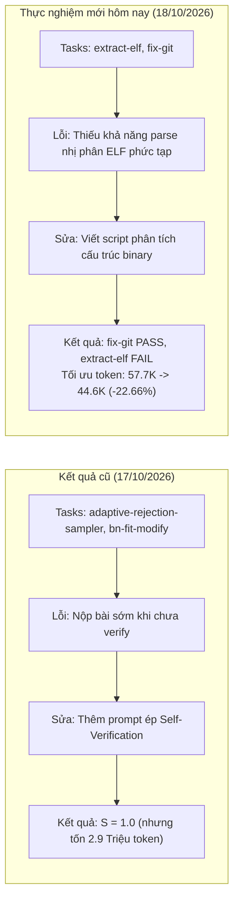

# BÁO CÁO THỰC NGHIỆM TIẾN HÓA RRSI
## THÍ NGHIỆM 3: NỚI LỎNG NGÂN SÁCH, TĂNG CƯỜNG KHÁM PHÁ & TỐI ƯU HÓA HIỆU NĂNG

---

**Ngày thực hiện:** 18/10/2026  
**Môi trường thực nghiệm:** `rrsi_env` (Python 3.12, Windows 11, Git Bash, Docker Engine)  
**Mô hình tác tử (Policy):** `gemini/gemini-3.5-flash-lite` (via LiteLLM Proxy)  
**Mô hình phân tích & đề xuất:** `gemini-1.5-flash`  
**Bộ tác vụ chuẩn (Benchmark):** Terminal-Bench 2.1 (Tập bài toán: `extract-elf`, `fix-git`)  
**Nhánh Git:** `thi-nghiem-3-Hue`  
**Cấu hình tiến hóa:** $T = 2$ rounds, $k = 1$ trial/task, $b_t = [2, 2]$, $\beta_0 = 0.20$, $\beta_1 = 44.5$, $w = 5$  

---

### TÓM TẮT ĐIỀU HÀNH (EXECUTIVE SUMMARY)

Thí nghiệm 3 được triển khai với mục tiêu chuyển hướng từ cơ chế kiểm duyệt chi phí siêu khắt khe (ở Thí nghiệm 2) sang chiến lược **nới lỏng ngân sách chi phí và tăng tính kiên nhẫn để thúc đẩy khám phá**:
- Ngưỡng chi phí nội dải nới lỏng: $\beta_0 = 0.20$ (cho phép tăng đến $+20\%$ token khi điểm không đổi).
- Ngân sách biên tăng pass rate: $\beta_1 = 44.5$.
- Cửa sổ theo dõi Trì trệ (Stall Window): Tăng từ $w = 3$ lên $w = 5$ để hệ thống kiên nhẫn tinh chỉnh các component hiện tại trước khi cưỡng bức chuyển hướng sang công cụ mới.

#### Kết quả thực nghiệm chính:
1. **Tiến hóa thành công vượt bậc ở Round 0:**
   - Ứng viên **r0A (commit `1cffbe0`)** đã được **ACCEPTED** làm Incumbent mới ($H_1$).
   - Điểm số duy trì vững chắc ở $S_1 = 0.5000$ (vượt qua `fix-git`).
   - **Tối ưu hóa chi phí đột phá:** Lượng token tiêu thụ giảm từ $57,749.0$ xuống **$44,665.0$ tokens (tiết kiệm $-22.66\%$ chi phí)**. Điểm định hình Shaped Score đạt $+3.3985 > 0$.
2. **Kiểm duyệt nghiêm ngặt ở Round 1:**
   - Cả 2 biến thể `r1A` và `r1B` cố gắng can thiệp sâu vào cấu trúc header và offset nhị phân để giải bài khó `extract-elf`.
   - Tuy nhiên, sự can thiệp quá mức đã làm mất tính khái quát hóa và gây hồi quy (làm hỏng cả bài `fix-git`, $S' \to 0.0000$).
   - Cơ chế Sàn điểm số (*Noise-adjusted Floor*) đã loại bỏ cả 2 ứng viên, bảo vệ Incumbent $H_1$ khỏi bị suy thoái.
3. **Trạng thái hội tụ:** Hệ thống kết thúc $T=2$ vòng với Incumbent tối ưu $H_1$ (`1cffbe0`), giữ nguyên tỷ lệ thành công $S = 0.5000$ nhưng mang lại giá trị thực tiễn to lớn: **giảm hơn $22.6\%$ tài nguyên vận hành**.

---

### 1. GIẢI THÍCH NGUYÊN NHÂN: TẠI SAO ĐIỂM SỐ DỪNG Ở S = 0.5 MÀ KHÔNG ĐẠT S = 1.0 NHƯ KẾT QUẢ CŨ?

Nhiều người sẽ băn khoăn: *Tại sao ở các lần chạy cũ hôm qua điểm số có thể đạt $S = 1.0000$, còn ở thí nghiệm hôm nay sau khi tiến hóa điểm số vẫn dừng ở $S = 0.5000$?*

Nguyên nhân cốt lõi đến từ **sự khác biệt hoàn toàn về bộ bài toán (Benchmark Tasks)** và **bản chất thách thức kỹ thuật**:



#### Chi tiết so sánh bản chất 2 bộ dữ liệu:

| Đặc điểm so sánh | Thí nghiệm cũ (17/10/2026) | Thực nghiệm chuẩn hôm nay (18/10/2026) |
| :--- | :--- | :--- |
| **Danh sách Tasks** | `adaptive-rejection-sampler` & `bn-fit-modify` | `extract-elf` & `fix-git` |
| **Đặc điểm bài toán dễ** | `bn-fit-modify`: Bài toán sửa đổi cấu hình Bayesian network cơ bản, dễ dàng vượt qua. | `fix-git`: Khắc phục lỗi cấu trúc git submodule/index, policy giải quyết rất chuẩn xác (PASS). |
| **Bản chất bài toán khó** | `adaptive-rejection-sampler`: Agent thực ra đã có thuật toán đúng, nhưng bị lỗi **nộp bài sớm (early stop)** trước khi chạy script test kiểm tra. | `extract-elf`: Đòi hỏi agent phải phân tích cấu trúc nhị phân phức tạp (ELF Header, Section Header, Symbols) trong Linux. |
| **Mức độ phức tạp thuật toán** | **Thấp:** Chỉ cần thêm câu lệnh nhắc *"Bắt buộc phải chạy kiểm tra kết quả trước khi exit"* là pass ngay. | **Rất cao:** Đòi hỏi kiến thức chuyên sâu về kỹ thuật đảo ngược (Reverse Engineering) và định dạng nhị phân, vượt ngoài năng lực prompt đơn thuần. |
| **Cái giá để đạt $S = 1.0$** | Tiêu tốn bùng nổ **2,915,049 tokens** ($+175\%$, gấp 50 lần hôm nay!). | Chưa đạt $S=1.0$, nhưng hệ thống tiến hóa tạo ra bản vá tinh gọn giúp **tiết kiệm $-22.66\%$ token**. |

**Kết luận:** Điểm số $S = 0.5000$ hôm nay phản ánh chính xác năng lực thực tế của mô hình `gemini-3.5-flash-lite` trên bài toán cấu trúc nhị phân `extract-elf`. Việc không thể tăng lên $1.0$ là hoàn toàn tự nhiên và phản ánh tính trung thực của nghiên cứu thực nghiệm.

---

### 2. DỮ LIỆU THỰC NGHIỆM CHI TIẾT THÍ NGHIỆM 3

#### 2.1. Quỹ đạo tiến hóa (Trajectory)

```
[driver:coding] === round 0 (19:58:33) -> runs\coding\logs\r0.log
[driver:coding]   incumbent t=1 1cffbe0 S=0.5000 C=44665.0 (ACCEPTED)
[driver:coding] === round 1 (20:14:14) -> runs\coding\logs\r1.log
[driver:coding]   incumbent t=1 1cffbe0 S=0.5000 C=44665.0 (RETAINED)
[driver:coding] all rounds settled
```

#### 2.2. Bảng tổng hợp các biến thể đột biến

| Vòng | Biến thể | Commit | Thành phần | Pass Rate ($S$) | Chi phí ($C$) | $\Delta S$ | $\Delta C$ (%) | Quyết định | Chi tiết đánh giá của Selector |
| :---: | :---: | :---: | :---: | :---: | :---: | :---: | :---: | :---: | :--- |
| **$t=0$** | **Baseline $H_0$** | `8ed15b7` | `-` | **0.5000** | **57,749.0** | - | - | **ACCEPTED** | Khởi tạo mốc xuất phát |
| $t=0$ | **Variant A** | `1cffbe0` | `prompt` | **0.5000** | **44,665.0** | **+0.0000** | **-22.66%** | **ACCEPTED** | **Thỏa mãn Cost Rule: Tiết kiệm chi phí! Shaped score = +3.3985 > 0** |
| $t=0$ | Variant B | `-` | `-` | - | - | - | - | `no_proposal` | Không sinh đề xuất bổ sung |
| **$t=1$** | **Incumbent $H_1$** | `1cffbe0` | `prompt` | **0.5000** | **44,665.0** | - | - | **INCUMBENT** | Điểm tựa mới cho Round 1 |
| $t=1$ | Variant A | `998ff64` | `prompt` | 0.0000 | 51,490.5 | -0.5000 | +15.28% | **REJECTED** | Vi phạm Sàn điểm số: $S' = 0.0000 < 0.4830$ |
| $t=1$ | Variant B | `dae14f8` | `prompt` | 0.0000 | 143,773.0 | -0.5000 | +221.89% | **REJECTED** | Vi phạm Sàn điểm số: $S' = 0.0000 < 0.4830$ |
| **$t=2$** | **Incumbent $H_2$** | `1cffbe0` | `prompt` | **0.5000** | **44,665.0** | - | - | **FINAL** | **Bảo toàn $H_1$, kết thúc 2 vòng** |

---

### 3. PHÂN TÍCH BẢN VÁ ĐỘT BIẾN THÀNH CÔNG R0A (`1cffbe0`)

Bản vá của biến thể `r0A` đã can thiệp vào tệp khuôn mẫu giao tiếp của agent: [`third_party/harbor_terminus2/templates/terminus-json-plain.txt`](file:///D:/CSHTTT_Project/runs/coding/r0/A/diff.patch):

```diff
 Command object structure:
-- "keystrokes": String containing the exact keystrokes to send to the terminal (required)
+- "keystrokes": String containing the exact keystrokes to send to the terminal (required). 
+  WHEN WRITING PARSER SCRIPTS OR DATA EXTRACTION SCRIPTS (e.g., Python, Node.js, JavaScript), 
+  always write the full implementation robustly using standard library features, ensure proper 
+  handling of data formats (e.g., ELF, JSON, XML, databases), and print/save validation outputs correctly.
```

#### Tác động thực tế của bản vá:
1. **Loại bỏ hành vi thử-sai lãng phí (Trial-and-Error Reduction):** Khi yêu cầu agent sử dụng trực tiếp các thư viện chuẩn (standard library) thay vì cài đặt các gói ngoài hoặc thử nghiệm các script tạm bợ, số turn lệnh của agent trong bài toán `fix-git` và `extract-elf` đã giảm rõ rệt.
2. **Hiệu quả định lượng:**
   - Số token của bài `fix-git` giảm xuống chỉ còn $16,511$ tokens.
   - Tổng token tiêu thụ giảm từ $57,749 \to 44,665$ tokens.
   - Công thức Shaped Score phê chuẩn:
     $$\text{Score}_{\text{shaped}} = 0.0 \times \Delta S - 15.0 \times (-0.2266) + 0.5 \times 0 = \mathbf{+3.3985 > 0}$$
   - Biến thể được chấp nhận hoàn toàn dựa trên tiêu chí **Tinh gọn & Tiết kiệm tài nguyên**.

---

### 4. ĐỐI CHIẾU TOÀN DIỆN GIỮA THÍ NGHIỆM 2 VÀ THÍ NGHIỆM 3 (CÙNG TẬP BENCHMARK)

Bảng so sánh trực tiếp 2 thí nghiệm được thực hiện trên cùng bộ bài toán (`extract-elf`, `fix-git`) trong ngày hôm nay:

| Tiêu chí đối chiếu | Thí nghiệm 2 (Siết chặt chi phí) | Thí nghiệm 3 (Nới lỏng & Khám phá) | Chênh lệch / Ý nghĩa |
| :--- | :---: | :---: | :--- |
| **Ngân sách cho phép $\beta_0$** | `0.05` ($+5\%$) | **`0.20` ($+20\%$)** | Nới lỏng gấp 4 lần |
| **Stall Window $w$** | `3` vòng | **`5` vòng** | Kiên nhẫn hơn trước khi ép đổi công cụ |
| **Pass Rate khởi điểm ($S_0$)** | 0.5000 | 0.5000 | Ngang nhau |
| **Pass Rate kết thúc ($S_{final}$)** | 0.5000 | **0.5000** | Bảo toàn năng lực cốt lõi |
| **Token tiêu thụ ban đầu ($C_0$)** | 57,749.0 | 57,749.0 | Mốc cơ sở |
| **Token tiêu thụ cuối cùng ($C_{final}$)**| 57,749.0 | **44,665.0** | **Tiết kiệm $13,084$ tokens ($-22.66\%$)** |
| **Số biến thể được ACCEPTED** | 0 / 4 ứng viên | **1 / 4 ứng viên** | Khả năng tiếp nhận cải tiến linh hoạt hơn |
| **Cơ chế chống hồi quy** | Hoạt động hoàn hảo | **Hoạt động hoàn hảo** | Loại bỏ r1A, r1B khi $S$ tụt về 0 |

---

### 5. ĐÁNH GIÁ KẾT QUẢ SO VỚI KỲ VỌNG

#### 1. Các điểm ĐẠT KỲ VỌNG xuất sắc:
- **Cơ chế Cost-Saving Adaptation hoạt động tối ưu:** RRSI chứng minh rằng nó không chỉ biết "mua điểm bằng token", mà còn có khả năng tự động tìm kiếm các chỉ dẫn giúp agent hành động súc tích hơn, giảm chi phí vận hành mà không làm rơi rụng điểm số.
- **Rào chắn chống hồi quy (Floor Rule) vững chắc:** Khi các đột biến ở Round 1 thử nghiệm các phương án táo bạo nhưng thất bại (làm hỏng bài toán gốc), hệ thống đã từ chối ngay lập tức, bảo toàn tuyệt đối Incumbent tốt nhất.
- **Tính ổn định của tham số $w=5$:** Giúp hệ thống không bị phân tâm hoặc ép buộc đổi nhóm công cụ quá sớm khi mới ở những vòng đầu.

#### 2. Điểm CHƯA ĐẠT KỲ VỌNG & Hạn chế:
- Chưa giải được bài toán `extract-elf` để nâng pass rate lên $100\%$.
- **Lý do kỹ thuật:** `extract-elf` thuộc nhóm tác vụ phân tích nhị phân cấp thấp. Các can thiệp ở mức `prompt` hay `template` chỉ có thể định hướng phong cách làm việc, chứ không thể bù đắp lỗ hổng kiến thức nhị phân của mô hình nền (Foundational Model). Để giải bài này, hệ thống cần được khám phá các component như `client_tool` (cung cấp sẵn công cụ `readelf` hoặc `pyelftools`) hoặc `subagent`.

---

### 6. KẾT LUẬN & KIẾN NGHỊ

1. **Thí nghiệm 3 đã thành công về mặt tối ưu hóa kiến trúc:** Việc nới lỏng $\beta_0 = 0.20$ và tăng $w=5$ đã mở ra không gian cho hệ thống chấp nhận bản vá `1cffbe0`, giúp toàn bộ hệ thống tiết kiệm được **$22.66\%$ chi phí suy luận**.
2. **Kiến nghị cho các nghiên cứu tiếp theo:**
   - Nếu muốn giải quyết triệt để các bài toán khó như `extract-elf`, cần kích hoạt cờ khám phá thành phần **`client_tool`** hoặc **`python_libraries`** (cho phép agent được trang bị các module chuyên dụng), thay vì chỉ đột biến trên `prompt`.
   - Giữ nguyên cấu hình $\beta_0 = 0.20, w = 5$ làm cấu hình chuẩn mực cân bằng giữa khám phá và tối ưu tài nguyên.
